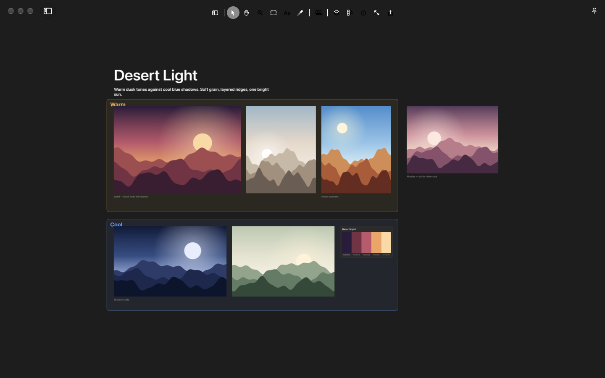

# Muse

Reference boards for designers. Collect images from Finder, any browser, Pinterest, the clipboard or a screenshot onto an infinite board, arrange them into sections, and export the board to a layered Photoshop file.



- Infinite dark canvas: pan, zoom, select, move, scale (Photoshop-style handles and modifiers).
- Tools with Photoshop keys: **V** move, **H** / Space hand, **Z** zoom, **M** section, **T** type, **I** eyedropper (with Pigment).
- Sections (become layer groups in the PSD), text, image captions, layer names, Layers panel (F7), Image Info (⌘I) with tags and notes.
- Projects with several boards; a **Library** (⌘L) of every image across projects with search, tags and Quick Look.
- Import: drag from Finder (files or whole folders), drag from browsers (Muse fetches the full image), Pinterest (fetches the original size), paste (⌘V), and **⌥⇧4** anywhere to screenshot straight onto the board.
- Window modes: Normal, Float (on top), Peek (translucent) and Trace (click-through, so you can trace over it in another app); **⌥⇧T** toggles Trace from anywhere.
- **Export as PSD** (⇧⌘E): 8-bit RGB with layer groups for sections and palettes, captions as layers (text is rasterized).

## Requirements

- macOS 26 or later.
- **Screen Recording** permission for the ⌥⇧4 screenshot hotkey (macOS asks the first time).
- Optional: **Pigment** for color palettes. Palettes (the drawer, the eyedropper, Make Palette from Image) are made and stored by Pigment; without it installed, Muse hides those tools and everything else works on its own.
- Optional: Photoshop, to open exported PSDs.

## Install

**Download:** get [Muse.zip](https://github.com/byaydenrx/Muse/releases/latest/download/Muse.zip) from the [latest release](https://github.com/byaydenrx/Muse/releases/latest) (Apple silicon and Intel, macOS 26 or later).

1. Double-click `Muse.zip` to unzip it, and drag **Muse** into your Applications folder.
2. Open it. Because the app isn't notarized by Apple, macOS says it can't verify it: click **Done**.
3. Open System Settings › Privacy & Security, scroll down to “Muse was blocked”, click **Open Anyway** and confirm. You only do this once.

**Or build it yourself** (no Gatekeeper prompt), with Swift 6 from the Xcode Command Line Tools (`xcode-select --install`) or Xcode:

```sh
git clone https://github.com/byaydenrx/Muse.git
cd Muse
./install.sh
```

`install.sh` builds Muse, copies it to `~/Applications` and opens it. `./build.sh` only builds `build/Muse.app`.

## Data

- `~/Documents/Muse/<Project>/project.json` — boards, layout, names, tags, notes
- `~/Documents/Muse/<Project>/images/` — a copy of every image added
- `~/Documents/Muse/<Project>/Exports/` — PSD exports (default location)
- Log: `~/Library/Logs/Muse.log` (trimmed to the newest 256 KB once it passes 1 MB) (records drop types and the sites images came from, never full addresses)

Images dragged from websites are downloaded by Muse from the address the browser provides (or the page's preview image), and the page address is saved with the image so you can open it later. Plain `http://` addresses are fetched over https.

## Keyboard

Help › Keyboard Shortcuts (⌘/) lists everything. Library (⌘L): arrows move, Space is Quick Look, Return places on the board, type to search, Esc goes back.

## Test modes

`Muse --selftest out.png <images> [--psd out.psd]` (imports, lays out, renders and exports using temp folders unless `MUSE_ROOT` / `PIGMENT_ROOT` are set), `--shot out.png` (draws the window into a PNG, without the translucent sidebar, then quits).

## License

MIT — see [LICENSE](LICENSE).
